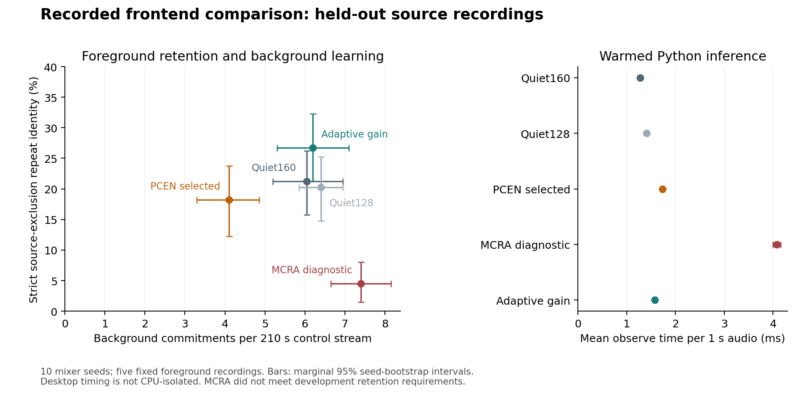

# Published frontends for recorded novelty: a source-separated comparison

**Status:** Frozen development and held-out evaluation completed and audited.
PCEN trades fewer background commitments for missed foreground episodes;
the tested MCRA adapter retains only 4.5% strict repeat identity. No method
avoids frequent background commitments; semantic relevance remains unevaluated.

## Question

The recorded pilot in [paper 07](07-recorded-replay-and-source-exclusion.md)
found frequent background attention and prototype commitments even when
gain compensation improved recording-specific recall. The question here is
whether established normalization and adaptive noise estimation primitives
improve this trade-off in the same bounded discovery system. The desired
behavior is retaining novel and recurring foreground structure while
reducing learning of the background bed. A detector that rejects everything
does not satisfy that objective.

The experiment compares adapters around PCEN and MCRA with the existing
quiet-band method. It does not reproduce their original keyword-spotting or
speech-enhancement systems, or establish a state-of-the-art comparison.

## Published methods and the discovery backend

Wang et al. introduced PCEN for robust keyword spotting and also trained its
parameters jointly with a recognizer. This study uses fixed PCEN parameters
and no keyword recognizer or supervised acoustic model [1]. Direct
`librosa.pcen` 0.11 calls retain filter state across observations. Input uses
magnitude mel bands, a 2**31 amplitude scale and restored Hann-window scale.
Our 32 HTK bands and 32 ms windows differ from the original frontend; the
hop is 10 ms. An additional quiet-frame estimate converts PCEN values into
detector evidence [2].

Cohen and Berdugo's MCRA estimates noise power using smoothed spectral
minima and signal-presence-dependent updates [3]. Our adapter uses their
16 kHz, 512-sample FFT, 128-sample hop, .8/.95/.2 smoothing, threshold 5 and
125-frame minimum-block settings. Frequency weights [.25, .5, .25] and
nearest-edge extension are declared choices. The first power frame
initializes noise; the current estimate precedes the next-frame update.
This is MCRA rather than IMCRA, and no OM-LSA enhancement stage is included.

All four families use the same recurrence confirmation, candidate lifetime,
96-dimensional three-part feature representation and capacity of 32 admitted
prototypes. The quiet-band method is run at both 160- and 128-sample hops,
providing the MCRA geometry control. An untuned adaptive-gain actor remains
an anchor. Detection and stored features are separate: feature mode 0 uses
raw spectral excess; mode 1 uses relative detector features. In particular,
PCEN detection with mode 0 does not mean that PCEN features are stored.

Each one-second observation computes an unpadded STFT separately. The
PCEN/MCRA spectral state persists, but boundary frames omitted by this API
are not reconstructed. Streaming parity tests concern the supplied spectral
frames, not an equivalence to continuous waveform framing. All methods
share this observation API. Sustained sources and contaminated startup
remain relevant limitations.

## Inputs and split reservation

The previous pilot's folds 1 and 5 are already observed. A new
[metadata-only reservation](data/esc10-published-reservation/README.md) uses
fold 2 for development and fold 4 for evaluation. It archives the prior
catalog and excludes every original Freesound source ID in it, including
alternative takes. Twenty newly selected source IDs are mutually distinct
and disjoint from the twenty pilot sources. Selection uses pinned upstream
metadata and lexical filename order, without choosing favorable waveforms.

The reservation preceded new audio materialization. Its ten development
recordings were downloaded first: five foreground categories and five
background categories, each a complete five-second recording. Evaluation
materialization followed the archived development selection and commit
`5cfe07c`. The catalog builder enforces separate partition downloads and
verifies WAV
format, file hashes and individual attribution. ESC-10 data retain their
upstream CC BY 3.0 terms and source attribution [4].

Source-ID separation does not establish different creators, equipment or
recording sessions. There is one recording per category and partition, and
category labels supply neither precise event boundaries nor clean stems.
An injected recording can itself contain unwanted sounds.

## Frozen tuning and selection

[published-protocol.json](results/masked-events/published-protocol.json)
pins primitive parameters, method-source hashes, dependencies, sources,
seeds, grids and selection rules before development decisions are observed.
Each family has exactly 12 configurations:

| Factor | Values |
|---|---|
| Family | quiet160, quiet128, PCEN160, MCRA128 |
| Local detection threshold | 1.5, 2.5, 3.5 |
| Broad detection threshold | 1.15, 1.5 |
| Stored feature mode | raw excess, relative evidence |

Thus there are 48 candidate configurations and one untuned anchor. Published
smoother parameters are fixed; there is no additional hidden PCEN/MCRA
search. Development uses seeds 2800–2801; final evaluation reserves
2900–2909. Each seed has four positive suites (recorded/modulated ambience
at whole-episode 0/−6 dB) and two pure-background controls. A no-target
control has no target SNR and is run once per ambience condition, avoiding
duplicated controls masquerading as independent evidence.

A configuration is feasible only if it achieves all of:

- At least 80% episode detection in **each** positive suite, averaged across
  the two development seeds.
- At least 60% mean first-episode novel attention across positive suites.
- At least 20% mean strict source-exclusion repeat identity across positive
  suites.

These are declared engineering screening thresholds, not statistical
guarantees or deployment requirements. Among feasible configurations,
selection minimizes mean pure-control admissions, then maximizes strict
repeat identity, minimizes wrong identity and breaks ties by configuration
ID. Selection is reported overall and within each stored-feature mode,
using the same existing grid. The full grid remains visible.

If a group is infeasible, its selected configuration is null. The report
also identifies its highest-strict diagnostic candidate, with background
admissions and wrong identity breaking ties. Such a candidate remains
explicitly infeasible; constraints are not relaxed. Final evaluation retains
the declared defaults and the deduplicated feasible or diagnostic choices,
alongside the untuned anchor. Development scores will not be presented as
held-out performance.

## Replay, exclusion and runtime evidence

Each 210-second stream contains twenty complete five-second foreground
episodes, four replays per recording, separated by background gaps. The
continuous room/microphone channel and recorded overlap-added bed match
across actors and positive/control suites. Whole-episode post-channel SNR
is checked against the current episode divided by residual audio, including
earlier episode tails. One-second source/residual RMS and SNR remain in raw
rows, since intrinsic source pauses invalidate a uniform masked-event SNR
interpretation.

The repeat denominator is the third/fourth physical replay, not adjacent
windows from one clip. A correct identity must use a prototype admitted
before the current episode. The primary strict endpoint additionally rejects
an episode if any matching source-removal probe still recognizes that
recording. Probes remove the entire current episode's physical channel
contribution, copy actual prior learner state for each window and discard
their updates. They retain earlier actual exposure; they are not a complete
episode-deleted learning history. The less strict, same-window-conditioned
endpoint and wrong-identity rates are retained as separate diagnostics.

Identity scoring assigns a prototype the recording label of its admission
window. The stored candidate vector may have been created in an earlier
window, so admission labels do not prove the origin of a mixed-stream
prototype. Source removal tests current-episode dependence of recognition,
not the origin of every stored feature. Pure no-target controls remain
unambiguous evidence that the system commits background prototypes. The
candidate-provenance audit in ch-6w4.10.7 addresses the mixed-stream ambiguity.
Its evaluator-only tracer now passes exact decision/memory comparisons
across eight frontend families and isolates copied-branch histories;
recorded replay and birth-label rescoring remain pending. No reported score
has been replaced by a birth-label diagnostic.
Here, background denotes the experimental bed; it does not mean every sound
in that recording is intrinsically unimportant to a robot.

Runtime uses `perf_counter_ns` around each actual `observe`, excluding
rendering, branch copying and probe observations. Imports/JIT are warmed
using disposable actors before measurements; the first three measured
warmup windows are excluded from summaries. Per-window durations and host,
dependency and thread settings are retained. These timings concern this
Python implementation on a shared desktop, without CPU isolation or
hardware energy measurements; they do not establish algorithmic efficiency.

Source/input/output hashes, attributed full-duration component examples,
every observation and source-removal result, per-recording counts and the
complete development selection are archived. An independent offline audit
checks the expected matrix, SNR/components, paired backgrounds, source
separation, method parameters, metrics, timings and exact selection rule.

## Development findings: selection data

The completed archive at
[`published-development/`](results/masked-events/published-development/)
contains 123,480 actual observation decisions: 49 actors × 210 windows ×
6 suites × 2 seeds. It additionally records 39,200 source-removal probe
decisions. The offline audit verified the complete matrix, physical
components/SNR, source/method/input/output hashes, timings and exact
selection from raw rows. All 121 software tests pass; the original grader
scores 1.0. No hardware is exercised.

| Family's overall choice | Strict repeat identity | Mean control admissions per 210 s | Wrong repeat identity | Feasible settings / 12 |
|---|---:|---:|---:|---:|
| Quiet160, raw, local 3.5 / broad 1.5 | 47.5% | 8.50 | 83.75% | 12 |
| Quiet128, raw, local 3.5 / broad 1.5 | 42.5% | 8.50 | 85.00% | 10 |
| PCEN160, raw, local 2.5 / broad 1.5 | 31.25% | 5.25 | 56.25% | 5 |
| MCRA128 diagnostic, raw, local 3.5 / broad 1.5 | 13.75% | 6.25 | 71.25% | 0 |

Strict identity and wrong identity are averaged over the four positive
suites and two seeds, with 80 eligible repeat episodes per configuration.
Correct and wrong matches can occur in different windows of the same
episode, so their rates are not complements. Background commitments are
averaged over four unique no-target streams. These are development values
used for selection, with only five foreground recordings.

The selected PCEN adapter reduces background commitments relative to the
quiet-band choice on this development split, while retaining fewer strict
repeat identities. This is a trade-off rather than a broad improvement.
Its lowest suite-level episode detection is 87.5%, with 92.5% mean
first-episode novel attention. All MCRA settings fail the declared strict
retention requirement; even the best diagnostic retains only 13.75%.
Detection and novelty are high in that diagnostic (95% each), demonstrating
that detecting change alone does not establish stable source identity.

The full grid, feature-specific selections, infeasibility labels and
deduplicated evaluation list are in `selection.json`. Final evaluation used
nine configurations plus the untuned adaptive-gain anchor. The raw PCEN
default is retained alongside its tuned choice; its development detection
and strict recall do not meet the declared screening requirements. Both
raw and relative feature choices remain represented. No additional tuning
or threshold relaxation follows these outcomes.

## Held-out findings

The evaluation archive at
[`published-evaluation/`](results/masked-events/published-evaluation/)
contains 126,000 actual decisions and 40,000 source-removal probes across
sixty 210-second streams. All method settings, defaults, feature-specific
choices and development infeasibility labels remained fixed. The offline
audit verified the complete matrix and recomputed physical, timing and
identity evidence. The separate
[`published-comparison/`](results/masked-events/published-comparison/)
archive preserves a descriptive paired-seed aggregation and its sources.

The following means equally weight the four positive suites or the two
unique control suites, then the ten seeds. Strict-repeat intervals resample
seeds jointly across suites, retaining condition/SNR correlation. They are
conditional on five fixed foreground recordings, not corpus-generalization
intervals. There are 400 eligible repeat episodes per method, with 80 per
recording; those repeats are not independent source recordings.

| Method | Strict identity %, 95% interval | Control commitments / 210 s | Control attention % | Episode detection % | Wrong identity % | Observe ms |
|---|---:|---:|---:|---:|---:|---:|
| Quiet160, raw default/selected | 21.25 [15.75, 26.25] | 6.05 | 77.98 | 99.75 | 91.25 | 1.27 |
| Quiet128, raw default/selected | 20.25 [14.75, 25.25] | 6.40 | 78.00 | 99.75 | 91.00 | 1.41 |
| PCEN160, selected raw | 18.25 [12.25, 23.75] | 4.10 | 47.60 | 89.75 | 53.75 | 1.73 |
| MCRA128, raw diagnostic | 4.50 [1.50, 8.00] | 7.40 | 57.90 | 96.50 | 81.50 | 4.08 |
| Adaptive-gain anchor | 26.75 [21.25, 32.25] | 6.20 | 48.95 | 98.25 | 72.25 | 1.58 |

The paired PCEN-minus-Quiet160 difference is −1.95 commitments per control
stream [−2.65, −1.20], but −3.00 percentage points of strict identity
[−6.75, +1.00] and −10.00 points of episode detection [−11.88, −8.13].
This supports a background-attention/retention trade-off on these inputs,
not superior foreground learning. The adaptive anchor has a descriptive
+5.50-point strict difference from Quiet160 [0.00, +11.25]; that interval
does not establish broad superiority. These exploratory contrast intervals
are not adjusted for multiple comparisons.

The standalone [SVG](results/masked-events/published-comparison-figure/comparison.svg)
and PNG preserve their input report, plotting source and hashes. Timing is
mean warmed actual-observe cost, excluding source-removal probes, rendering,
copying and initial calibration. It measures these Python implementations
on this shared desktop. In particular, MCRA's Python per-frame loop is not
an estimate of optimized MCRA algorithmic complexity or embedded power use.

### Condition dependence and missed events

| Positive suite | Quiet160 strict % | Quiet128 strict % | PCEN selected strict % | MCRA diagnostic strict % | Adaptive strict % |
|---|---:|---:|---:|---:|---:|
| Recorded, 0 dB | 43 | 37 | 28 | 5 | 30 |
| Recorded, −6 dB | 17 | 16 | 14 | 4 | 20 |
| Modulated, 0 dB | 19 | 20 | 21 | 8 | 34 |
| Modulated, −6 dB | 6 | 8 | 10 | 1 | 23 |

PCEN's unmodulated episode detection falls to 86.5% at 0 dB and 72.5% at
−6 dB, compared with Quiet160's 99.5% in each. Its development detection
constraint therefore does not transfer to the −6 dB evaluation suite.
Under modulation PCEN detects every episode, yet wrong-identity episodes
reach 95% at both SNRs. Quiet160 reaches 100% wrong identity under modulated
−6 dB. Detecting change is clearly insufficient for stable identity here.
Wrong and correct recognition can occur within the same episode; the
admission-label ambiguity described above also limits these identity labels.

Performance differs by recording, not just suite. Strict hits across all
conditions and seeds are:

| One held-out recording | Quiet160 / 80 | PCEN selected / 80 | MCRA diagnostic / 80 | Adaptive / 80 |
|---|---:|---:|---:|---:|
| Sneezing | 10 | 23 | 1 | 4 |
| Rooster | 17 | 5 | 3 | 32 |
| Crying baby | 27 | 26 | 1 | 35 |
| Clock tick | 11 | 0 | 6 | 8 |
| Dog | 20 | 19 | 7 | 28 |

These are eighty eligible replays of one file per row. PCEN's overall result
conceals better sneeze replay and loss of clock-tick identity; it does not
show generalization to those categories. Quiet160's development strict mean
was 47.5%, versus 21.25% here; selected PCEN falls from 31.25% to 18.25%.
The partitions change both fixed recordings and mixer seeds, so those shifts
cannot isolate source diversity from seed variation or selection effects.

### Stored-feature and default controls

The full ten-configuration table and paired contrasts remain in the
comparison archive. At matched thresholds, relative features change
Quiet160 strict identity from 21.25% to 20.50% while control commitments rise
from 6.05 to 12.65; Quiet128 changes from 20.25% to 21.25% with commitments
6.40 to 12.50. MCRA raw/relative changes 4.50% to 2.25% and 7.40 to 12.80
commitments. Relative storage does not resolve background learning here.

The separately selected PCEN relative pipeline yields 11.75% strict identity
and 15.70 control commitments, but also uses a different broad threshold
from the raw choice. That comparison cannot isolate the feature mode.
The untuned raw PCEN default yields 12.00% strict identity and 3.50 control
commitments; fewer commitments alone do not make it a preferable learner.
No evaluation result triggers retuning or a relaxed feasibility criterion.

## Remaining scope

The frozen comparison is tracked in Beads ch-6w4.7.2. The resulting priorities
are candidate birth/admission provenance (ch-6w4.10.7), continuous STFT
framing (ch-6w4.7.3), and MCRA noise/feature-state drift diagnostics
(ch-6w4.7.4). The latter must distinguish sustained-source noise absorption,
initialization and representation drift from a presumed implementation
failure. Existing observed recordings can support diagnosis; revised methods
require a new frozen source split for evaluation.
Active-support calibration without cropping remains ch-6w4.1.4; broader
categories and more original recordings remain ch-6w4.1.3. Importance and
one-off relevance learning remain ch-6w4.3. These methods can emphasize
spectral change without establishing that a learned sound matters to the
robot. Neither recording replay nor source exclusion supplies semantic
relevance labels. Physical capture and cue-echo validation still require
the bench work recorded in `HUMAN_TODO.md`.

## References

1. Wang, Y., Getreuer, P., Hughes, T., Lyon, R. F., & Saurous, R. A. (2017).
   *Trainable frontend for robust and far-field keyword spotting*. ICASSP,
   5670–5674. [Primary publication](https://research.google/pubs/trainable-frontend-for-robust-and-far-field-keyword-spotting/).
2. librosa 0.11.0. [PCEN implementation and streaming/input-scale documentation](https://librosa.org/doc/0.11.0/generated/librosa.pcen.html).
3. Cohen, I., & Berdugo, B. (2002). *Noise Estimation by Minima Controlled
   Recursive Averaging for Robust Speech Enhancement*. IEEE Signal Processing
   Letters, 9(1), 12–15. [Author manuscript](https://webee.technion.ac.il/Sites/People/IsraelCohen/Publications/SPL_Jan2002.pdf).
   [DOI](https://doi.org/10.1109/97.988717).
4. Piczak, K. J. (2015). *ESC: Dataset for Environmental Sound Classification*.
   ACM Multimedia, 1015–1018. [DOI](https://doi.org/10.1145/2733373.2806390).
   Exact upstream attribution and metadata accompany the reserved catalog.

Codex assisted with implementation, execution, auditing and drafting. Aidan
Jones retains responsibility for interpretation. This is an exploratory
project report, not a peer-reviewed paper.
