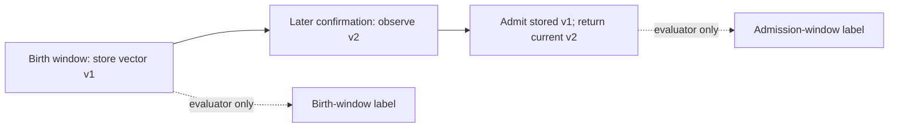

# When prototype labels depend on admission time

**Status:** Observed-recording replay and independent audit completed.
Birth and admission labels differ for 1,739 of 4,194 mixed-stream prototype
instances across ten correlated settings. Both scoring views are retained;
neither establishes the acoustic cause or relevance of a stored feature.

## Question

[Paper 08](08-published-frontends-and-recorded-novelty.md) compared fixed
quiet-band, PCEN, MCRA and adaptive-gain discovery pipelines. They detect
change much more readily than they retain recording-specific identity.
An additional evaluation ambiguity is now explicit: a pending candidate
keeps its first stored feature vector, but the scorer labels a new prototype
using the recording present when it is admitted. Confirmation may happen
in a different recording episode or a no-target window.

At admission, the learner's returned observation contains the **current**
embedding; its persistent prototype contains the **earlier candidate**
embedding. Those can be different byte sequences within the matching
radius. Admission-window labels therefore do not establish the recording
context that produced the stored vector. This audit asks how often the two
window labels differ and how sensitive the published identity metrics are
to that choice.

Birth labels are not corrected ground truth. A recording window contains
both an injected source and the background bed; the stored feature could
depend on either. A no-target window can also retain the previous source's
room tail. Temporal context and acoustic causality remain distinct.

## Waveform-only instrumentation

The evaluator constructs fresh instrumented actors with identical settings
and the original learner methods. Deterministic candidate IDs distinguish
lifetimes even when feature bytes match. Events record creation, observations
with before/after hit counts and previous observation tick, admission,
recognition, retirement and any stored-vector changes. A candidate retains
its birth tick across confirmation and admission. Tick 1 maps to replay
step 0.

Feature hashes use little-endian float32 bytes. Stored and current-observation
hashes are separate. Immutable event histories let copied source-removal
branches share their past while appending separate futures; probe history
does not enter actual history. Recording, episode and physical-tail labels
are joined by the evaluator only after observing audio. No labels or stems
enter the learner.

Tests compare exact decisions and candidate/prototype contents across eight
frontend families and copied source-removal branches. They exercise adjacent
observation gaps, immediate admission, capacity/TTL retirement, pending
resets, stored-vector changes and invalid inputs. Loading existing memory is
rejected because saved prototypes do not contain their historical births.
The instrumented actor is an evaluator tool, not a bounded live logger.

## Replay and label-sensitive scoring

The replay uses the already observed fold-4 inputs, original seeds 2900–2909,
the same nine settings plus adaptive-gain anchor, four positive suites and
two unique background-control suites. These are exactly the paper-08
settings; no grid is rerun and no parameter is selected from this audit.

Every actual output row and source-removal decision is compared with the
original archive, omitting only the recorded runtime field. Physical episode
metadata, component-recombination error and background-output hashes must
also match. The historical classifier, scene and scorer source bytes must
match the frozen protocol before replay. The audit does not replace or
overwrite historical archives.

After each stream, the evaluator validates complete lifecycle coverage,
candidate/prototype IDs, confirmation gaps, feature-hash continuity and
event/window context. Every admission is classified by its **window labels**:
same recording; recording to background; background to recording; different
recordings; or background to background. Background births with nonzero
prior-source tails remain separate from bed-only births. These names do not
identify the physical cause of a feature.

A separate explicit-label scorer copies the original episode rules, changing
only the recording label assigned to a prototype. Given admission labels,
it must reproduce the original scorer exactly in every stream. Given birth
labels, it supplies a parallel diagnostic. Physical episode truth, actual
admission timing, eligibility of third/fourth replays, prior-episode
prototype requirements and source-removal rules remain fixed.

The primary strict diagnostic requires a correct pre-episode prototype and
no recognition of that recording by any corresponding source-removal probe
in the episode. Probe labels use the same mapping as actual labels. The
less strict same-window-conditioned endpoint, ordinary repeat identity,
wrong identity and deletion identity remain available. Correct and wrong
matches can occur in different windows of one episode; their rates are not
complements.

Paired seed-bootstrap summaries retain correlation across the four positive
suites. Their intervals condition on five fixed foreground recordings;
repeated exposure and sixty mixer streams are not sixty independent source
recordings. A score change is label sensitivity on observed data, not
evidence of a new learner or corpus-generalization performance.

## Replay and provenance findings

The complete replay verified all 126,000 original output decisions and
40,000 source-removal decisions, with no difference beyond the deliberately
omitted runtime field. The independent offline audit validated 121,767
lifecycle events, 5,940 admissions and both score mappings. It checks the
archived original links and trace/score consistency; it does not render audio
again. The replay itself performed the waveform-based equality checks.
All 140 software tests pass, the original grader remains 1.0 and compilation
passes. The original learner, scene and scorer bytes remain unchanged.

There are 4,194 admissions in positive streams and 1,746 in pure controls.
Across the positive streams, 530 cross from a recording-labelled birth
window to a no-target admission window, 768 cross in the opposite direction,
and 441 cross between different recording labels. The remaining 1,058 have
the same recording label and 1,397 have no target at either point. These
counts pool prototype instances across ten related settings and forty
positive streams; they are not independent acoustic sources or an estimated
corpus incidence.

| Pipeline | Mixed-stream admissions | Recording to no-target | No-target to recording | Different recordings | Different labels / total |
|---|---:|---:|---:|---:|---:|
| Quiet160 raw | 357 | 32 | 69 | 36 | 137 / 357 |
| Quiet128 raw | 366 | 33 | 69 | 44 | 146 / 366 |
| PCEN selected raw | 284 | 25 | 45 | 30 | 100 / 284 |
| MCRA raw diagnostic | 306 | 45 | 75 | 34 | 154 / 306 |
| Adaptive-gain anchor | 388 | 36 | 52 | 46 | 134 / 388 |

Of the 768 no-target-to-recording cases, 83 birth windows have prior-source
tails and 685 do not. Of the 530 recording-to-no-target cases, 94 admission
windows have prior-source tails. Thus neither transition direction alone
establishes a spurious background prototype or a genuine foreground one.
The tail metadata and complete admission records remain available.

No stored-vector hash changes between birth and admission in this replay.
All 5,940 admission observations have different exact feature bytes from the
stored prototype. This confirms that the returned current embedding cannot
substitute for the stored candidate when tracing its history. Different
hashes do not establish a large perceptual difference or a different acoustic
source; candidate matches remain governed by the original distance rule.

## Identity scores depend on the label convention

The following strict source-exclusion values equally average the four
positive suites within seed, then ten seeds. Intervals are paired
seed-bootstrap label differences, conditional on five fixed recordings.
These are exploratory post-run diagnostics, without multiple-comparison
adjustment. No learner parameter or decision changes.

| Pipeline | Admission-label strict % | Birth-label strict % | Birth minus admission pp, 95% interval |
|---|---:|---:|---:|
| Quiet160 raw | 21.25 | 24.75 | +3.50 [+0.50, +6.75] |
| Quiet128 raw | 20.25 | 24.50 | +4.25 [+1.00, +8.00] |
| PCEN selected raw | 18.25 | 20.00 | +1.75 [−0.25, +3.50] |
| MCRA raw diagnostic | 4.50 | 4.50 | 0.00 [−2.75, +2.25] |
| Adaptive-gain anchor | 26.75 | 32.50 | +5.75 [−0.50, +12.25] |

Birth labeling does not simply lower an optimistic admission score. It can
recover the context of an earlier recording-labelled candidate admitted
during a no-target window, remove another candidate's later recording
label, and change how the same source-removal match is classified. Synthetic
tests exercise both score directions. The unchanged MCRA aggregate also
does not imply identical episode classifications; per-seed changes can
cancel.

The net gain is concentrated by recording. Strict hits, with eighty eligible
replays of each single file, are:

| Recording | Quiet160 admission / birth | PCEN selected admission / birth | Adaptive admission / birth |
|---|---:|---:|---:|
| Sneezing | 10 / 9 | 23 / 23 | 4 / 4 |
| Rooster | 17 / 21 | 5 / 6 | 32 / 32 |
| Crying baby | 27 / 26 | 26 / 25 | 35 / 36 |
| Clock tick | 11 / 11 | 0 / 1 | 8 / 8 |
| Dog | 20 / 32 | 19 / 25 | 28 / 50 |

The dog file accounts for twelve of Quiet160's net fourteen extra strict
hits, six of PCEN's net seven and twenty-two of adaptive gain's net
twenty-three. This is repeated exposure to one recording, not evidence of
better category recognition. Wrong-identity episodes remain high: Quiet160
changes from 91.25% to 94.75%, selected PCEN from 53.75% to 52.50%, and
adaptive gain from 72.25% to 73.50%. Correct and wrong matches can coexist
within an episode.

Pure-control admissions are unaffected: Quiet160 commits 121 prototypes,
Quiet128 128, selected PCEN 82, MCRA raw 148 and adaptive gain 124 across
twenty controls each. All 1,746 control admissions across all ten settings
have no-target births, no-target admissions and no prior foreground tails.
Changing the label convention therefore does not explain away the
background-bed commitment problem reported in paper 08.

## Limits and next work

This audit measures when and how a persistent feature was committed. It does
not infer semantic importance or determine which component of a field
recording caused an embedding. Birth/admission labels can both be misleading
as causal labels. Pure no-target controls remain the clearest evidence of
background-bed commitments under the experimental role assignment.
Source-removal probes retain actual prior learner exposure; deleting a
window's audio contribution does not delete earlier learning from that
source. Neither scoring view reconstructs a wholly source-deleted learning
history.

Beads ch-6w4.10.7 tracks this completed audit. Follow-up ch-6w4.10.8 measures
feature dependence at birth and confirmation using same-prior-state
foreground-removal probes, including older tails where relevant. It will
compare detection, regions and similarity to the stored vector. Such probes
are evaluator evidence; clean stems must not become a deployable admission
oracle.

The completed [feature-dependence replay in paper 10](10-selected-features-and-background-reproducibility.md)
preserves all 126,000 original decisions and covers 28,813 candidate feature
observations, including never-admitted candidates. It distinguishes unchanged
audio, region reselection and bed-reproducible stored matches. Quiet160 has
152/853 bed-reproducible births in recording-labelled windows where removal
actually changes the delivered waveform. This remains evaluator evidence
conditional on prior actual exposure, not a semantic label or admission rule.

The source-diversity, active-support-SNR,
continuous-framing and MCRA-state investigations in paper 08 remain relevant.
Any admission-policy or representation change derived from these observed
recordings needs a new frozen source evaluation. Human bench dependencies
remain in `HUMAN_TODO.md`; this software audit needs no new human input.

## Evidence

[`published-provenance/`](results/masked-events/published-provenance/)
preserves exact source/input/output hashes, original raw observations,
waveform-replay assertions, lifecycle/context events, individual admissions
and both per-stream/per-recording scores.
[`published-provenance-report/`](results/masked-events/published-provenance-report/)
preserves the descriptive aggregation, paired label contrasts and links to
the replay. Both archives have independent offline audit commands.

The original [frozen scorer](results/masked-events/published-evaluation/source/python/src/chuff_mpu/sim/recorded_metrics.py)
and [stored-candidate implementation](results/masked-events/published-evaluation/source/python/src/chuff_mpu/attention.py)
define the historical behavior being audited. The waveform-only tracer is
documented in `python/src/chuff_mpu/sim/PROVENANCE.md`; paper 08 supplies the
PCEN/MCRA primary references, dataset provenance and original results.

Codex assisted with implementation, execution, auditing and drafting. Aidan
Jones retains responsibility for interpretation. This is an exploratory
engineering report, not a peer-reviewed paper.
